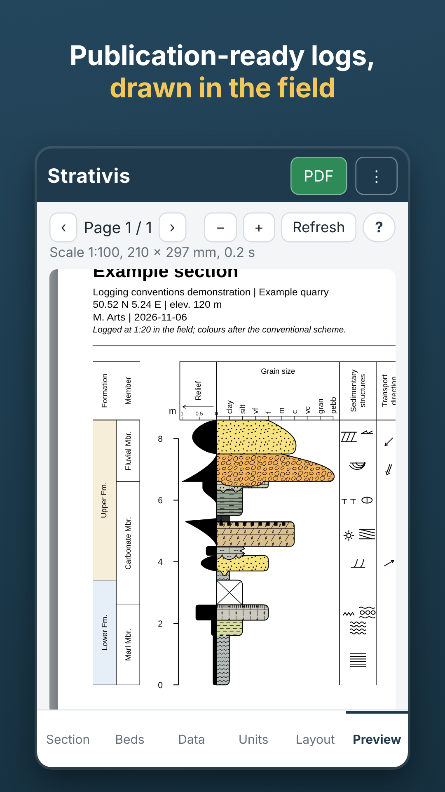
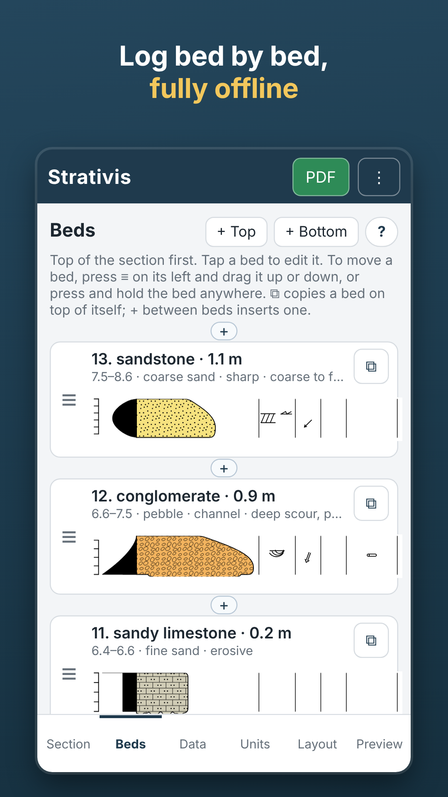
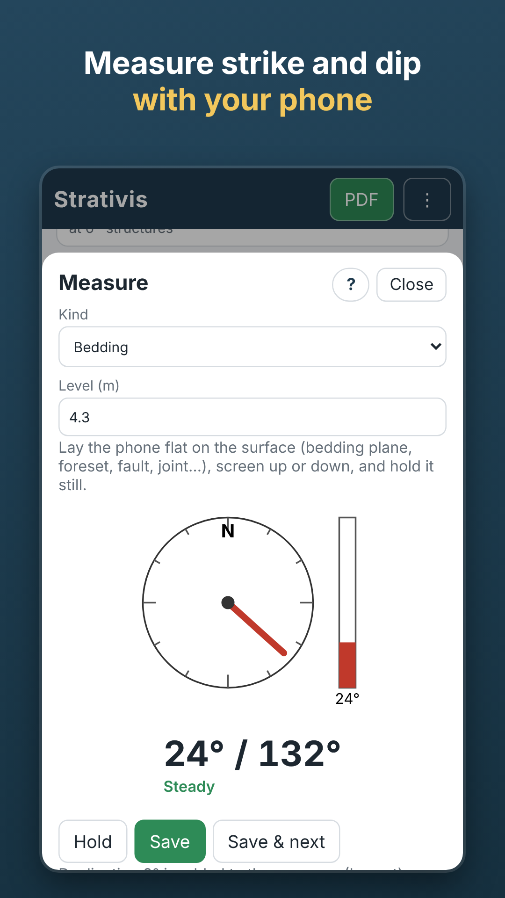

# Strativis for Android

Draw publication-ready sedimentary logs in the field, on your phone and fully offline.

  

* Log bed by bed: add beds anywhere, drag to reorder, with a mini preview of each bed.
* About 190 sedimentological symbols, 70 lithology patterns, relief column, rounded beds and shaped contacts.
* Lithology colours: schemes, a rock-colour chart (approximate Munsell), a colour wheel or a colour picked from an outcrop photo.
* Print-ready PDF at true vertical scales, with title block and automatic legend.
* Export sections for R (Strativis, StratigrapheR, WaverideR and other packages), JSON projects and CSV.
* No account, no adverts, no tracking. Your data stays on your phone.

## Download

* **GitHub:** the APK under [Releases](../../releases). Allow "Install unknown apps" for your browser when Android asks.
* **F-Droid:** [f-droid.org/packages/org.strativis.app](https://f-droid.org/packages/org.strativis.app/) (after the F-Droid review).
* **Google Play:** coming soon.
* **iPhone and iPad:** open [stratigraphy.github.io/strativis-android](https://stratigraphy.github.io/strativis-android/) in Safari and add it to the home screen (the page shows how). It works offline and keeps your sections on the device; no App Store or account needed.

Install from one source only: the versions are signed with different keys, so you cannot update one with another without uninstalling first (export your sections before uninstalling).

## How it works

The app is a small Java wrapper (`app/src/main/java`) around a web interface (`app/src/main/assets/www`). The logs are drawn by `app/src/main/assets/www/engine/`, a JavaScript port of the R packages **lithoglyph** and **Strativis** (built on **StratigrapheR**, Wouters et al. 2021, *The R Journal* 13(2): 153–178). It gives the same logs and PDF files as the R packages, without R on the phone, and needs no internet connection.

* `engine/rgfx.js`: the part of R base graphics the code uses, with a canvas backend (preview) and a vector PDF writer.
* `engine/lg_*.js`: lithoglyph (patterns, colours, symbols, beds, relief, log columns).
* `engine/sv_*.js`: Strativis (projects, page layout, legend, export for R).
* `tools/make_metrics.R`: generates the font metrics in `engine/metrics.js`.
* `web/`: the iPhone and iPad version, the same web interface as a web app. `Rscript web/build_site.R site` builds it; the `gh-pages` branch holds the published copy.

## Building

Open this folder in Android Studio (JDK 17 or newer, Android SDK 36) and build the `directRelease` variant, or from a terminal:

```
./gradlew assembleDirectRelease
```

Build variants: `direct` (this repository's releases, with the donation link) and `play` (Google Play).

## Author and support

Dr Michiel Arts, Sedimentary Petrology, Department of Geology, Université de Liège (ULiège), Belgium.

Strativis is free. If it helps your fieldwork or publications, you can support its development: [paypal.me/stratigraphy1](https://paypal.me/stratigraphy1).

Symbols, patterns and colours follow common sedimentological logging conventions, as compiled for example in the Sedimentology Utrecht logging legend and in Nichols (2009), *Sedimentology and Stratigraphy*.

When you publish a log made with Strativis, please cite Strativis and StratigrapheR.

## Licence

GPL-3.0-or-later, see [LICENSE](LICENSE).
